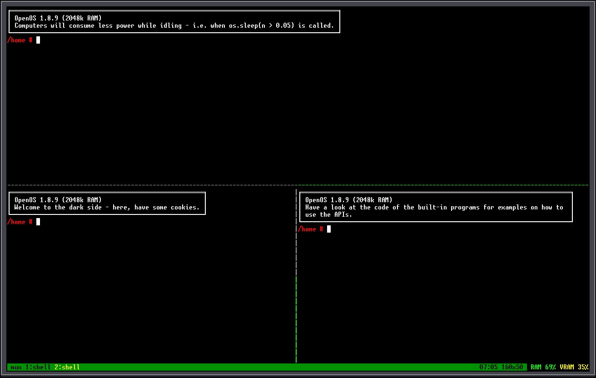

<h1>
	mux
	<a href="https://0rwx.com"></a>
</h1>

---



A tmux-like terminal multiplexer for OpenComputers (on OpenOS).
One session, many terminal panes, detach and re-attach from any terminal on the
machine.

## Install

Copy two files into the machine's filesystem (Floppy/Disk):
```
src/bin/mux.lua		->	[/usr]/bin/mux
src/lib/muxd.lua	->	[/usr]/lib/muxd.lua
```

## Usage

    mux                   attach to the session, creating it if missing
    mux attach            same
    mux new CMD...        start CMD in a new window (creates session if none)
    mux list              list windows
    mux kill-session      end the session, freeing all panes

There is exactly **one session per machine** (it lives in the machine's Lua
heap under `_G.mux_session`), and one attached client at a time. Running `mux`
in a second terminal steals the screen from the first; the old client prints
"terminal was taken over" and exits.

Detaching (`^B d`) quits the client but keeps every pane running — programs
keep producing output, keep pumping events (except keyboard), and are waiting
for you when you `mux` again. If the attached `mux` process dies for any other
reason (machine reboot excepted), a watchdog reparents the panes back to init
so they never freeze.

## Keys

`^B` is the prefix. The status line shows `mux+` while a prefix is armed.
`^B ^B` cancels.

The right end of the status line reports free machine memory and free video
memory (the buffers one per pane are carved out of it) as percentages, each
coloured green over 50%, yellow over 25%, red below that. More windows than fit
are cut with `...`, and the selected window is always kept in the visible list.

| after `^B` | action                                        |
|------------|-----------------------------------------------|
| `%`        | split active pane into left and right halves  |
| `"`        | split active pane into top and bottom halves  |
| `x`        | kill active pane                              |
| `&`        | kill active window                            |
| `c`        | new window (shell)                            |
| `n` / `p`  | next / previous window                        |
| `0`-`9`    | jump to window 1-10                           |
| `o`        | cycle pane within the window                  |
| `h j k l`  | focus pane left/down/up/right                 |
| arrows     | resize the active pane's split                |
| `z`        | toggle zoom (active pane fills the work area) |
| `w`        | rename window (prompt on the status line)     |
| `d`        | detach (session keeps running)                |
| `q`        | kill session and exit                         |
| `^B`       | cancel the prefix                             |
| `^C`       | send an interrupt to the active pane          |

Mouse input (touch/drag/drop/scroll) is mapped geometrically: coordinates are
translated to whichever pane covers that point, so mouse apps work per-pane.

## Drawbacks

- Currently doesn't implement any kind of scroll buffer like tmux does
- As mentioned before, only one session per machine (but you can make windows), and only one attached client at a time
- No kind of `mux-in-mux` protection, don't try anything funny!
